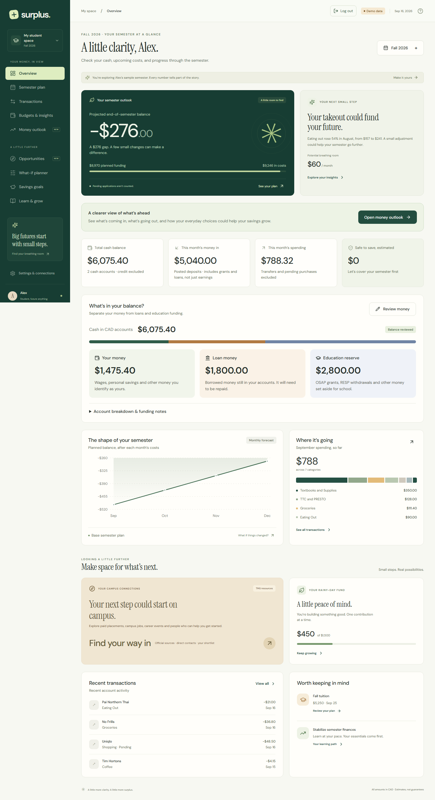
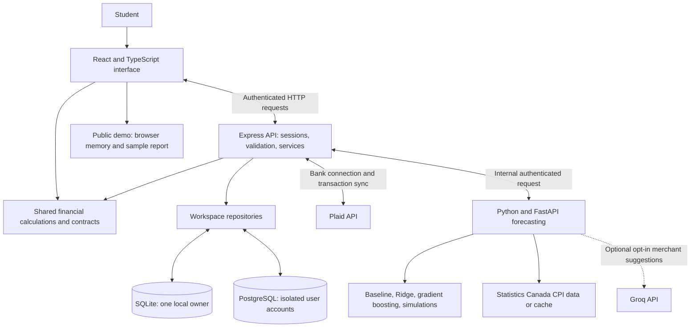

# Surplus

**Your semester, with room to grow.**

Surplus is a student financial planning application that connects semester costs, funding, bank transactions, budgets, savings goals, and cash-flow forecasts. It helps students understand what money is available, what needs to be paid, and how a change in spending or work could affect the rest of the semester.

**React 19 · TypeScript · Node.js · Express · PostgreSQL / SQLite · Plaid · Python · FastAPI**

[Features](#key-features) · [How it works](#how-it-works) · [Architecture](#architecture) · [Getting started](#getting-started) · [Technical guide](docs/technical-guide.md)

## At a glance

| Question | Answer |
| --- | --- |
| Who is it for? | Students managing tuition, school funding, part-time/co-op income, everyday spending, and savings. The initial resource catalog focuses on Toronto Metropolitan University (TMU). |
| What problem does it solve? | Connects the semester plan with everyday financial activity, making funding gaps and upcoming cash needs easier to understand. |
| What can someone try? | A fictional student workspace with editable budgets, transactions, goals, and scenarios through the account-free demo. |
| What makes it interesting technically? | Reliable bank-data synchronization, shared financial logic, authenticated account workspaces, PostgreSQL isolation, and locally evaluated Python forecasts. |
| Does it require a bank or AI account? | No. Demo data and entered plans work without bank credentials. Personal forecasting runs locally; external merchant suggestions are optional. |
| What is its current status? | A locally runnable full-stack application. Public hosting and production-scale operation are not established by this repository. |

## Overview

A student may receive a large funding deposit at the start of a term, earn wages every two weeks, and pay tuition before much of that income arrives. An account balance alone does not explain how much is available for everyday spending or whether the semester is covered.

Surplus connects those pieces. Students enter expected costs and funding, review imported or demo transactions, set budgets and goals, and inspect an explained money outlook. Grants, loans, earned income, and pending applications remain distinct so the plan does not treat every deposit as disposable income.

The idea came from discovering paid campus projects and Learning Zone stipends by chance while looking for ways to cover school costs. The app links financial planning with a sourced student resource hub so users can understand a gap and explore a possible next step.

## Preview

<details>
<summary>View the desktop overview with fictional demo data</summary>



An existing application capture of the seeded Alex demo, using the fixed September 16, 2026 snapshot. Values are fictional examples, not measured user outcomes. Individual screens may evolve as development continues.

</details>

## Key features

### Semester planning and student money

- **Guided onboarding:** enter school details, semester costs, funding, goals, and preferences through a full or quick setup path. Browser drafts can be resumed.
- **Semester funding plan:** separate confirmed/received funding, expected job income, pending applications, repayable loans, and non-repayable grants.
- **Work schedules:** enter co-op, campus, part-time, and summer jobs with pay frequency and first/last paydays. Projected wages stop when the saved schedule ends.
- **Funding review:** flag deposits as loans, OSAP, grants, scholarships, or RESP and distinguish personal money from education funding.
- **Budgets and goals:** edit monthly category limits, track savings goals, inspect emergency coverage, and review a conservative safe-to-save estimate.
- **What-if planning:** compare spending reductions, extra income, future expenses, and goal allocations without silently editing the base plan.

### Banking and transaction review

- **Optional Plaid connections:** connect supported Canadian institutions through Plaid Link, or use Sandbox test accounts and a student fixture.
- **Transaction explorer:** search, filter by month/category/account/type, paginate records, and review pending transactions.
- **Corrections that persist:** change merchant/category/classification fields and save rules for future imports from the same source.
- **Merchant evidence and cleanup:** distinguish a business from its payment processor, retain original bank descriptions, and show correction evidence.
- **Financial-data normalization:** convert bank amount conventions into consistent cash flow and avoid counting transfers or credit-card payments as additional spending.
- **Sync lifecycle:** handle added, modified, and removed transactions; preserve corrections; stage paginated results before committing data and cursor together.

### Money outlook and financial intelligence

- **Cash-flow ranges:** combine entered obligations, pay schedules, recurring patterns, and variable spending forecasts.
- **Student outlook:** explain tuition coverage, term-end cash, remaining job pay, and gaps between work terms.
- **Goal timelines and liquidity:** compare competing savings goals and inspect short-term cash pressure without moving money.
- **Spending behavior:** review recurring charges, unusual purchases, weekday patterns, and available bank-supplied timing/location evidence.
- **Model transparency:** display training/validation history, model comparisons, assumptions, and reasons for falling back to a simple baseline.
- **Forecast history:** save comparisons and collect future 7/30/90-day observations; the existence of the journal is not proof of achieved accuracy.
- **Canadian card comparisons and education:** explain estimated rewards, fees, investing readiness, and hypothetical compound growth. TFSA room is entered manually.

### Student resources and product experience

- **TMU resource hub:** a curated catalog of 31 resources, including all 10 campus Zones, paid placement routes, awards, campus jobs, mentoring, and learning initiatives.
- **Resource tracking:** search/filter, inspect source-review dates and published requirements, save notes/follow-up dates, open official links, and download known dates to a calendar.
- **Clearly separated examples:** fictional opportunities demonstrate matching and funding scenarios without presenting invented listings as active opportunities.
- **Responsive interface:** reusable editors, financial charts, keyboard controls, reduced-motion support, mobile navigation, and locally served fonts.
- **Account controls:** local passwords, revocable sessions, optional Google/Microsoft/email-code sign-in, financial JSON export, and workspace deletion.

## How it works

### Try a complete student journey

1. **Explore the demo:** open the fictional workspace with no login or bank credentials.
2. **Review the semester:** inspect costs, funding, and the projected end balance.
3. **Understand spending:** filter transactions, inspect categories, and correct an entry.
4. **Try a change:** compare a spending reduction or additional income with the base plan.
5. **Explore goals and resources:** review savings progress and student opportunities.
6. **Save your own plan:** create an account and complete onboarding. Banking is optional.

The public demo runs in browser memory and resets on reload. It includes nine months of reproducible CAD transactions and a labelled pre-generated Python forecast. A signed-in plan uses persistent storage; personal forecast requests use the Python service.

### From a bank record to a useful insight

```text
Student consents through Plaid Link
    → backend exchanges and encrypts the access token
    → transaction pages are collected using a saved sync cursor
    → amounts/categories are normalized and corrections are preserved
    → transactions and the new cursor are committed together
    → shared calculations update budgets and spending summaries
    → selected financial inputs can feed a local Python forecast
```

A **sync cursor** is a bookmark indicating how far bank updates have been processed. Saving the bookmark with its data prevents the app from advancing past updates it has not saved. Failed sync retains previous data, and pagination mutations retry from the original cursor up to three attempts.

### From a plan to a forecast

```text
Current financial snapshot + entered expenses/funding + selected options
    → Express validates the request and selects financial inputs
    → authenticated FastAPI service checks bounded input contracts
    → Python separates scheduled events from variable activity
    → candidate models are evaluated on later holdout weeks
    → repeatable cash-flow simulations are assembled
    → charts, explanations, and model details return to the app
```

A **holdout** is a later slice of history kept out of model training so it can be used to evaluate predictions. Surplus compares a recent-average baseline with Ridge regression and histogram gradient boosting. Learned models require enough history and at least 5% lower holdout error to replace the baseline; **5% is a selection threshold, not a reported improvement**.

The engine produces 400 repeatable simulated paths and shows percentile ranges. These describe modeled scenarios, not guaranteed balances or calibrated success probabilities.

## Architecture

**In plain language:** React presents the plan, Express validates requests and manages accounts/banking, the database remembers financial records, and Python calculates the deeper money outlook. Shared TypeScript functions keep the app's everyday financial rules consistent.



**Data boundaries:** bank credentials and encrypted access tokens stay on the server. Python receives selected financial fields rather than Plaid tokens. Optional Groq requests send eligible merchant descriptors for suggestions; core financial calculations and local forecasting do not require an external AI account.

### Persistence modes

| Mode | What it provides | Important boundary |
| --- | --- | --- |
| Public demo | Fictional editable workspace in browser memory | No login; resets on reload; sample forecast |
| SQLite | One-owner local saved workspace | Default without `DATABASE_URL`; not a multi-user deployment mode |
| PostgreSQL / Supabase PostgreSQL | Separate accounts and user-owned financial records | Custom backend authentication; Supabase Auth is not used |

PostgreSQL operations use a restricted runtime role, transaction-scoped verified identity, forced **row-level security** (database rules limiting which user's records can be accessed), and per-workspace row locks. Forecast inference runs outside the database transaction so CPU-intensive analysis does not hold its row lock. See [database architecture](docs/database.md).

## Tech stack

| Layer | Technology | Purpose |
| --- | --- | --- |
| Interface | React 19, TypeScript, Vite | Typed screens, interactions, and frontend development/build tooling |
| UI and visualization | Original CSS, Motion, Recharts, Lucide, Fontsource | Responsive layouts, motion, charts, icons, and locally served fonts |
| API and contracts | Node.js, Express 5, Zod | Request handling, validation, and shared domain contracts |
| Persistence | PostgreSQL through `pg`; SQLite through `sql.js` | Separate user accounts or one-owner local storage |
| Banking | Plaid, react-plaid-link, AES-256-GCM | Bank connection, transaction updates, and access-token encryption |
| Identity | JWT/revocable sessions, scrypt, OpenID Connect, Nodemailer | Passwords, provider sign-in, and one-time email codes |
| Financial intelligence | Python 3.12, FastAPI, Pydantic, NumPy, scikit-learn | Bounded inputs, evaluated forecasts, and cash-flow simulations |
| Optional data/enrichment | Statistics Canada CPI; opt-in Groq suggestions | Explicit price scenarios and merchant cleanup |
| Verification | Node test runner, Supertest, pytest, Playwright, axe | Domain/API tests, Python tests, browser journeys, and accessibility checks |
| Automation | GitHub Actions and project CLI scripts | CI, database migrations, config checks, Sandbox verification, service setup |

## Engineering highlights

| Work demonstrated | Source to explore |
| --- | --- |
| Staged cursor sync, retries, encrypted tokens, and correction preservation | [Plaid adapter](backend/src/integrations/plaid.ts), [bank service](backend/src/services/plaid-service.ts) |
| Consistent cash-flow signs, transfer exclusions, and categorization precedence | [Financial domain](shared/finance/), [transaction service](backend/src/services/transaction-service.ts) |
| Account isolation and serialized workspace updates | [PostgreSQL repository](backend/src/repositories/postgres-workspace.ts), [migrations](backend/migrations/) |
| Cookie sessions, identity linking, and provider validation | [Authentication guide](docs/authentication.md), [identity integration](backend/src/integrations/identity-providers.ts) |
| Chronological model selection and ledger-aware simulations | [Models](services/intelligence/app/models.py), [engine](services/intelligence/app/engine.py) |
| Repeatable setup, local data import, and integration checks | [Scripts](scripts/), [CI workflow](.github/workflows/ci.yml) |

## Project structure

```text
Surplus/
├── frontend/src/
│   ├── App.tsx                  App navigation and workspace orchestration
│   ├── components/              Reusable controls, financial editors, charts
│   ├── features/                Auth, banking, intelligence, resources, demo
│   └── pages/                   Semester, transactions, budgets, goals, scenarios
├── backend/
│   ├── src/
│   │   ├── app.ts               API composition and middleware
│   │   ├── routes/              HTTP request validation and response adapters
│   │   ├── services/            Banking, corrections, forecasting, authentication
│   │   ├── repositories/        Workspace and resource persistence boundaries
│   │   ├── infrastructure/      SQLite, PostgreSQL, migrations, passwords
│   │   └── integrations/        Plaid, identity providers, mail, public data
│   └── migrations/              Versioned database schema and isolation policies
├── shared/
│   ├── schema.ts                Shared validated financial data contracts
│   ├── finance/                 Pure calculations reused across the application
│   └── demo.ts                  Reproducible fictional student data
├── services/intelligence/
│   ├── app/                     FastAPI, models, simulations, student/goal analysis
│   └── tests/                   Python financial and forecasting checks
├── tests/                       Domain/API, browser, and PostgreSQL checks
├── scripts/                     Setup, database, auth, banking, and import tools
├── docs/                        Technical guides and methodology
└── .github/workflows/           Continuous integration
```

**Start reading the code:** [shared/schema.ts](shared/schema.ts) → [financial calculations](shared/finance/) → [API composition](backend/src/app.ts) → [Plaid service](backend/src/services/plaid-service.ts) → [Python engine](services/intelligence/app/engine.py).

## Getting started

### Prerequisites

- **Node.js 20.12 or newer** and npm.
- **Python 3.12** for the forecasting service.
- No bank credentials, external AI account, or hosted database for the local demo.

### 1. Install and run

From the repository root:

```sh
npm ci
npm run intelligence:setup
npm run dev
```

The setup script creates a Python virtual environment and installs the locked dependencies. Development starts all three services:

| Service | Local address | Responsibility |
| --- | --- | --- |
| Frontend | `http://127.0.0.1:5173` | Browser interface |
| Express API | `http://127.0.0.1:3001` | Accounts, storage, bank requests |
| Python service | `http://127.0.0.1:8001` | Financial forecasting |

### 2. Try the product

Open **http://127.0.0.1:5173** and select **Try demo**. Review the semester plan, edit a budget, inspect transactions, and compare a scenario. To keep your own plan, create an account and complete onboarding.

### 3. Enable optional integrations

Copy `.env.example` to `.env` only if you need configuration changes, preserving any existing settings. All secrets belong on the server, never in `VITE_*` variables.

| Configuration | Enables | Required for the public demo? |
| --- | --- | --- |
| `DATABASE_URL` | PostgreSQL accounts and persistence; run `npm run db:migrate` | No |
| `PLAID_CLIENT_ID` + `PLAID_SANDBOX_SECRET` | Sandbox bank connection | No |
| `PLAID_CLIENT_ID` + `PLAID_PRODUCTION_SECRET` | Supported live Canadian bank connections | No |
| Google/Microsoft credentials or SMTP settings | Provider sign-in or email codes | No |
| `GROQ_API_KEY` plus in-app opt-in | Suggestions for unfamiliar merchant descriptors | No |
| `INTELLIGENCE_SERVICE_URL` / `INTELLIGENCE_SERVICE_TOKEN` | Override the internal Python endpoint/token | No; local defaults/key generation are supported |

Use one consistent browser address. If copying `.env.example`, its `AUTH_PUBLIC_ORIGIN` uses `http://localhost:5173`; set it to the exact address you use, such as `http://127.0.0.1:5173`, or consistently use the configured localhost origin. Provider callbacks must match that origin.

See the [complete environment and setup reference](docs/technical-guide.md), [database guide](docs/database.md), and [live banking guide](docs/live-banking-setup.md).

### Available scripts

| Command | Purpose |
| --- | --- |
| `npm run dev` | Start API, frontend, and Python service |
| `npm run intelligence:setup` | Create/install the local Python environment |
| `npm run intelligence:dev` | Run the Python service separately |
| `npm run check` | Type-check, lint, run Node/API tests, and build the frontend |
| `npm run test:intelligence` | Run Python financial/forecasting tests |
| `npm run test:e2e` | Run standard isolated browser journeys |
| `npm run test:e2e:intelligence` | Run browser journeys with a real isolated Python service |
| `npm run test:postgres` / `npm run test:e2e:postgres` | Run database integration/browser checks with dedicated test configuration |
| `npm run db:check` / `npm run db:migrate` | Check database connectivity / apply migrations |
| `npm run auth:check` / `npm run verify:plaid` | Inspect auth configuration / verify configured Sandbox workflows |
| `npm run build` / `npm start` | Build the frontend / serve it through the local API |

For the built app, open `http://127.0.0.1:3001`. Stop the development API first because it uses the same port. `npm start` does not start Python; run it alongside the API for personal forecasting. These commands serve locally rather than publicly deploying the app.

## API reference

The browser uses an authenticated HTTP API. The Python service is internal and separately authenticated.

| Method | Main endpoint | Purpose |
| --- | --- | --- |
| GET | `/api/health`, `/api/auth/session` | Health response / session state |
| POST | `/api/auth/register`, `/api/auth/login`, `/api/auth/logout` | Account/session lifecycle |
| GET | `/api/state`, `/api/resources` | Private workspace state / public resource catalog |
| PUT | `/api/workspace` | Save a validated financial plan |
| PATCH | `/api/transactions/:id` | Correct a transaction and optionally save a rule |
| GET / POST | `/api/transactions/enrichment` | Inspect / request merchant cleanup |
| POST | `/api/plaid/link-token`, `/api/plaid/exchange`, `/api/plaid/sync` | Connect and synchronize banking |
| DELETE | `/api/plaid/item` | Revoke/remove a bank connection |
| POST | `/api/intelligence/forecast` | Request a forecast and record its history |
| GET / DELETE | `/api/export`, `/api/data` | Export financial state / delete workspace data |

[Full API and service reference](docs/technical-guide.md#api-and-service-boundaries) includes provider flows and mode-specific behavior. Python exposes `/health`, `/v1/forecast`, and `/v1/enrich`; private endpoints require an internal service token.

## Testing and project status

The repository includes financial-domain tests, API tests, controlled bank/identity integration tests, Python forecasting tests, PostgreSQL isolation tests, browser journeys, and automated accessibility checks. The [CI workflow](.github/workflows/ci.yml) runs application checks, Python tests, and standard/intelligence browser suites on pushes and pull requests.

**Last recorded local run: November 16, 2026 — 158 Node/API tests passed and 90 Python tests passed.** Python reported two dependency deprecation warnings. That audit did not execute browser/PostgreSQL suites, builds, lint/type checks, or real bank/provider integrations. These are dated results rather than a claim that all current checks pass.

### Current limitations

- **Local operation:** the API binds to loopback. Public deployment requires separate hosting, proxy, operational, and privacy/security work.
- **Background synchronization:** opted-in live workspaces can poll every six hours while the backend is open. Public webhooks and a durable hosted scheduler are not implemented.
- **Financial estimates:** missing accounts, stale balances, incomplete history, or inaccurate inputs change results. CAD totals exclude unsupported currencies rather than inventing exchange rates.
- **Forecast interpretation:** simulated ranges and deadline-readiness shares are exploratory; measured accuracy, user savings, performance, and adoption are not established.
- **Resources and AI:** the TMU catalog is a reviewed snapshot, not automatic website monitoring. Forecast explanations are grounded in calculated results; optional merchant suggestions may be wrong and can be corrected.
- **Scope:** Surplus does not execute payments, trades, or transfers, calculate official TFSA room, or guarantee financial outcomes.

## Documentation

| Guide | What it explains |
| --- | --- |
| [Technical guide](docs/technical-guide.md) | Detailed setup, API, formulas, bank-sync behavior, tests, and limitations |
| [Database](docs/database.md) | PostgreSQL accounts, migrations, isolation, and guarded local imports |
| [Authentication](docs/authentication.md) | Sessions, provider identities, email codes, and security boundaries |
| [Financial intelligence](docs/financial-intelligence.md) | Model evaluation, simulation assumptions, privacy, and verification |
| [Behavioral intelligence](docs/behavioral-intelligence.md) | Purchase patterns, CPI scenarios, and liquidity methods |
| [Student money](docs/student-money.md) | Deposit classification and personal versus education funds |
| [Transaction enrichment](docs/transaction-enrichment.md) | Merchant evidence and persistent corrections |
| [Optional Groq cleanup](docs/groq-merchant-enrichment.md) | Configuration, opt-in, fallback, and merchant suggestions |
| [TMU resources](docs/tmu-resources.md) | Research sources, curation, tracking, and maintenance |
| [Repository description](docs/repository-about.md) | GitHub About text, topics, and a plain-language project summary |

## License

No standalone project license file is currently included. Third-party packages, fonts, and other assets retain their respective licenses; locally served DM Sans and Instrument Serif fonts use the SIL Open Font License.
